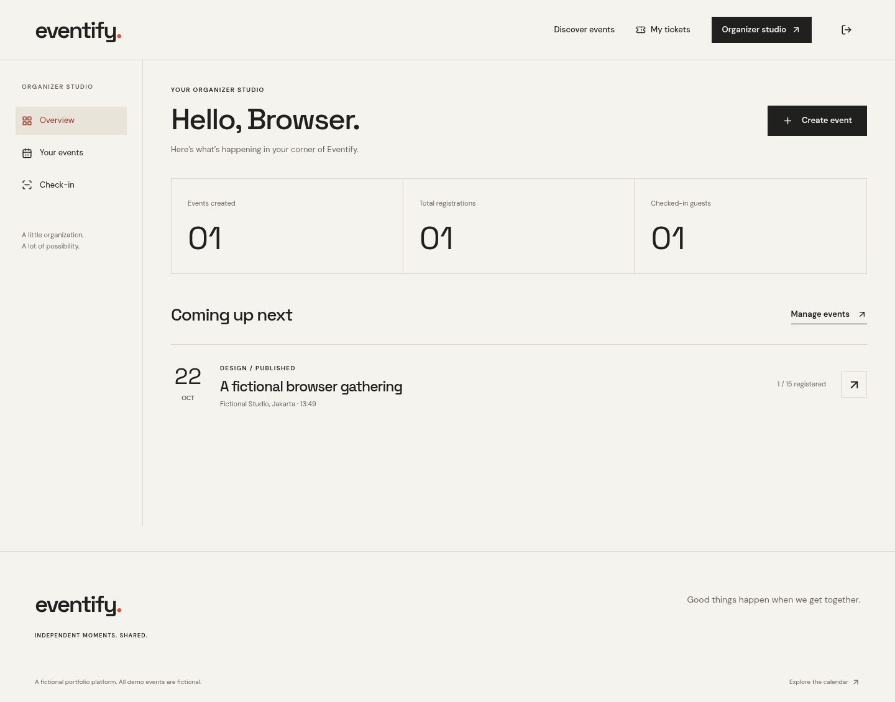
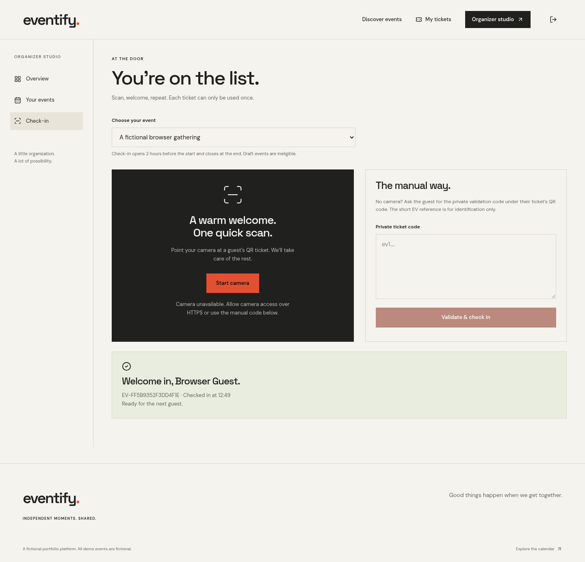
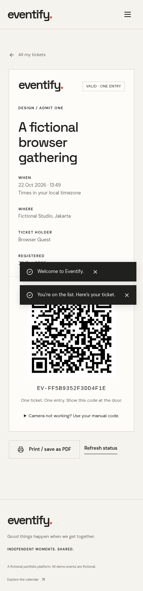

# eventify.

**Independent moments. Shared.**

Eventify is an event discovery and QR admission platform. Guests find free gatherings, reserve a place, and receive a personal digital ticket. Organizers publish events, manage guest lists, and check people in once, securely.

This is a fictional portfolio product. All six seeded events, their venues, and the organizer are fictional. No real gatherings are advertised.

## What’s included

- Responsive editorial discovery: featured events, search, category filters, upcoming/past filtering, and pagination.
- Registration and login with short-lived JWTs in HttpOnly cookies; no browser token storage.
- Attendee and organizer roles, enforced by Express on every protected endpoint.
- Organizer studio: create, edit, publish/unpublish, and delete eligible events; live registration and attendance counts; searchable guest lists.
- PostgreSQL transactions serialize reservations against an event’s capacity.
- Private digital tickets with QR images, copyable validation codes, and browser print / PDF support.
- Camera-based QR check-in with manual entry, event ownership validation, a check-in window, and atomic replay prevention.
- Field validation, keyboard navigation, focus indicators, accessible errors, notifications, loading states, and useful empty states.
- Local artwork and bundled fonts: no stock image or Google Fonts network dependency.

## Screenshots

Captured from the actual app by the browser tests. Event names, guest identities, and ticket data shown are disposable fixtures from the dedicated test database.


| Organizer studio                                     | Check-in                                           |
| ---------------------------------------------------- | -------------------------------------------------- |
|  |  |

| Mobile discovery                                 | Mobile ticket                                        |
| ------------------------------------------------ | ---------------------------------------------------- |
|  |  |

## Stack and architecture

| Layer          | Technology                                                                |
| -------------- | ------------------------------------------------------------------------- |
| Web            | Next.js App Router, React, JavaScript / JSX, Tailwind CSS, Lucide         |
| Forms          | React Hook Form, Zod, date-fns                                            |
| API            | Node.js, Express 5, JavaScript ES modules                                 |
| Persistence    | PostgreSQL 17, Prisma 6, versioned SQL migrations                         |
| Authentication | jsonwebtoken, bcryptjs, signed CSRF tokens, HttpOnly cookies              |
| HTTP hardening | Helmet, explicit credentialed CORS, rate limiting, bounded request bodies |
| Ticketing      | qrcode, html5-qrcode, Node crypto                                         |
| Verification   | Node test runner, Supertest, Playwright, axe-core                         |

```text
Browser → Next.js :3000 → /api rewrite → Express :4000 → Prisma → PostgreSQL :5432
                 pages & assets          auth, ownership, transactions
```

Prisma is pinned to version 6.19.3. The CLI’s `@prisma/config` dependency uses a scoped `deepmerge-ts` 8.0.2 override to address its recursion advisory; generation, migration, and both test runners are verified with that override.

Next proxies `/api/*` to the separate Express service. There are no Next API routes and no external auth service. API calls are same-origin in the default deployment, simplifying cookie delivery. The Express server is also independently addressable.

```text
apps/web/
  app/                 App Router pages and editorial styles
  components/          Discovery, forms, tickets, dashboard, scanner, shared UI
  lib/                 API client, data hooks, date formatting
  public/art/          Six original local SVG compositions
  tests/               Browser journeys and automated accessibility checks
apps/api/
  src/controllers/     HTTP handlers
  src/routes/          REST endpoint definitions and rate limits
  src/services/        Ownership, reservation, ticket, and check-in logic
  src/middleware/      Authentication, roles, CSRF, validation, error handling
  src/validators/      Zod request schemas
  src/utils/           Configuration, Prisma client, token primitives
  test/                Real PostgreSQL integration and race tests
prisma/                Schema, SQL migration, idempotent demo seed
scripts/               Guarded test runners and local setup helpers
docs/                  Screenshots and verification notes
```

## Local setup

Requirements: Node.js **22 or later**, npm, and Docker with Compose v2. Node 24 is used in this environment. A reachable PostgreSQL 17 instance can replace the Compose service.

Run commands from the repository root (the checkout may be named `event-ticketing`; do not create a nested `eventify` directory).

```bash
npm ci
npm run setup:local
npm run db:up
npm run db:generate
npm run db:migrate
npm run db:seed
npm run dev
```

`setup:local` creates a private, ignored `.env` from `.env.example`, generates three independent random secrets, and preserves an existing `.env`. Alternatively, copy `.env.example` yourself and replace all three secret placeholders with distinct random values. Never commit `.env`.

The web app listens on port **3000**, Express on **4000**, and the local database on **5432**. Open port 3000 in your local browser. The root `dev` command runs both Node services and stops the sibling process if one exits. No additional frontend environment file is needed.

The API health endpoint is `GET /api/health` and makes an actual database query. To check it locally:

```bash
curl --fail http://127.0.0.1:4000/api/health
```

The expected JSON is `{"data":{"status":"ok"}}`. This is an internal readiness check, not a hosted preview link.

### Environment configuration

| Name                | Purpose                                                            |
| ------------------- | ------------------------------------------------------------------ |
| `DATABASE_URL`      | Prisma PostgreSQL connection string                                |
| `TEST_DATABASE_URL` | Separate disposable database ending in `_test`                     |
| `JWT_SECRET`        | At least 32 random characters; signs 30-minute sessions            |
| `TICKET_SECRET`     | Independent 32+ character key; derives private QR credentials      |
| `CSRF_SECRET`       | Independent 32+ character key; signs CSRF tokens                   |
| `PORT`              | Express port, default 4000                                         |
| `WEB_ORIGINS`       | Comma-separated, exact allowed frontend origins                    |
| `COOKIE_SAME_SITE`  | `lax` by default; `none` only for cross-site HTTPS deployments     |
| `TRUST_PROXY_HOPS`  | Default 0; set to the exact trusted proxy hop count for deployment |
| `API_INTERNAL_URL`  | Express origin used by Next’s `/api` rewrite; set before building  |
| `NODE_ENV`          | Use `production` behind HTTPS when deploying                       |

Compose credentials in `.env.example` are **local development defaults**. Bindings expose PostgreSQL only on loopback. Use managed secrets and separate database credentials in production.

For a separately hosted, cross-site frontend/API, use `COOKIE_SAME_SITE=none` and `NODE_ENV=production`; cookies then have `Secure` and `HttpOnly`. Configure the exact web origin in `WEB_ORIGINS`. The default frontend continues using its same-origin Next proxy; a direct API client must send `credentials: 'include'` and fetch a CSRF token from that API origin. Browser third-party-cookie restrictions can still prevent a fully cross-site arrangement, so the same-origin proxy is the recommended deployment.

### Database lifecycle

```bash
npm run db:up              # Start PostgreSQL and wait for health
npm run db:generate        # Generate Prisma Client
npm run db:migrate         # Apply checked-in migrations (noninteractive)
npm run db:seed            # Local fictional demo data
npm run db:test:create     # Idempotently create eventify_test in Compose
npm run db:down            # Stop PostgreSQL; retain the volume
```

The SQL migration includes foreign keys, unique constraints, indexes, and checks on capacity, category, and date range. For a future schema change, edit `prisma/schema.prisma`, run `npx prisma migrate dev --name describe_change`, inspect the resulting SQL, and commit both schema and migration.

The seed refuses `NODE_ENV=production` and never resets existing accounts, events, or registrations. Run it only in development. Seed dates are relative to the **first** run; the featured event starts an hour later so check-in can be demonstrated immediately. Rerunning the seed preserves dates. Create a fresh event for a later demo rather than rewriting attendees’ plans.

### Local demo credentials

| Role      | Email                  | Password              |
| --------- | ---------------------- | --------------------- |
| Organizer | `host@eventify.local`  | `Eventify-demo-2026!` |
| Attendee  | `guest@eventify.local` | `Eventify-demo-2026!` |

These are deliberately public, local-only credentials. Never seed or restore this demo database into production. Organizers can also self-register by choosing “Host events & attend”; there is no privileged admin role.

### Production build

```bash
npm run lint
npm run build
npm start
```

The `build` script creates the Next production bundle. Express is JavaScript and runs directly without a compilation step. For a deployed environment, configure `NODE_ENV=production`, HTTPS, secrets, the exact web origin, the database, and the proxy hop count before starting. A local HTTP production-bundle smoke check can run without setting `NODE_ENV=production` on Express; it is **not** a production security configuration.

## Tests

```bash
npm run db:test:create
npm test
npx playwright install chromium
npm run test:e2e
```

For an already installed Chromium binary:

```bash
PLAYWRIGHT_CHROMIUM_EXECUTABLE_PATH=/usr/bin/chromium npm run test:e2e
```

- `npm test` applies migrations to `TEST_DATABASE_URL` and executes the API suite against real PostgreSQL. It covers validation, CSRF, roles, ownership, duplicates, sold-out events, the final-slot race, private tickets, invalid QR credentials, replay, simultaneous scans, and event integrity.
- `npm run test:e2e` **resets only the dedicated test database**, seeds fixtures, starts its own Express instance on 4100 and Next on 3100, and exercises desktop/mobile flows. It checks event creation/editing, registration, ticket delivery, manual check-in, replay, authentication, and selected WCAG A/AA rules with axe. It refreshes `docs/screenshots/`.
- Runners refuse a database name that does not end in `_test` or matches `DATABASE_URL`. Both runners mutate test data: do not run them concurrently against the same test database.
- Camera permissions and a physical device still need manual verification over HTTPS. The browser suite verifies QR decoding through a synthetic camera stream, the camera-unavailable fallback, and manual admission; hardware camera support varies by browser.
- Screenshots and axe checks do not establish full accessibility conformance. Keyboard, screen-reader, and real-device testing remain useful release checks.

See [verification notes](docs/VERIFICATION.md) for the actual checks executed during implementation.

## API overview

Successful JSON responses use `{ "data": ... }`; listings can include `meta`. Errors use `{ "error": { "code", "message", "fields"? } }`. Deletion returns HTTP 204. Validation returns 400, missing auth 401, forbidden access 403, missing resources 404, conflicts 409, and rate limits 429.

| Method | Endpoint                              | Access / behavior                                           |
| ------ | ------------------------------------- | ----------------------------------------------------------- |
| GET    | `/api/health`                         | Database readiness                                          |
| GET    | `/api/auth/csrf`                      | Set signed CSRF cookie and return token                     |
| POST   | `/api/auth/register`                  | Create attendee or organizer account                        |
| POST   | `/api/auth/login`                     | Set short-lived session cookie                              |
| POST   | `/api/auth/logout`                    | Clear session and CSRF cookies                              |
| GET    | `/api/auth/me`                        | Current authenticated user                                  |
| GET    | `/api/events`                         | Published events; `search`, `category`, `upcoming`, `page`  |
| GET    | `/api/events/:slug`                   | Published event detail and authoritative remaining capacity |
| POST   | `/api/events`                         | Organizer creates own event                                 |
| PATCH  | `/api/events/:id`                     | Owning organizer edits/publishes/unpublishes                |
| DELETE | `/api/events/:id`                     | Owning organizer; no registrations allowed                  |
| POST   | `/api/events/:id/register`            | Authenticated reservation and ticket, one per person        |
| GET    | `/api/registrations/me`               | Personal registrations                                      |
| GET    | `/api/registrations/:id`              | Registration owner only                                     |
| GET    | `/api/organizer/dashboard`            | Own totals and upcoming events                              |
| GET    | `/api/organizer/events`               | All own events including drafts                             |
| GET    | `/api/organizer/events/:id`           | Own editable event                                          |
| GET    | `/api/organizer/events/:id/attendees` | Own guest list                                              |
| GET    | `/api/tickets/:id`                    | Ticket owner; QR image and private validation payload       |
| POST   | `/api/tickets/check-in`               | Owning organizer; `{eventId, token}`                        |

Every mutation, including login and registration, requires an allowed `Origin`, the CSRF cookie, and a matching `X-CSRF-Token` header. Browser code handles this automatically. CLI clients must maintain a cookie jar and send both headers. CORS is not used as a substitute for CSRF validation.

## Integrity and security decisions

**Capacity.** Reservation begins with `SELECT ... FOR UPDATE` on the event, then checks publication, time, duplicates, and occupancy in the same transaction. Event edits/deletion acquire the same lock. A unique `(eventId, userId)` constraint reinforces the one-ticket rule. A concurrent final-slot loser receives `SOLD_OUT`; the UI never decides occupancy.

**Ticket identity.** Each ticket has a random UUID. Its QR payload is `ev1.<uuid>.<HMAC-SHA256>`, derived under the separate `TICKET_SECRET`; the database stores only the SHA-256 hash of that full credential. This allows the owner-only endpoint to reproduce a scannable QR without persisting the raw secret. Changing a UUID or signature produces an unknown hash. The short `EV-…` reference is not an admission credential. Keep `TICKET_SECRET` stable: rotating it requires an explicit ticket reissue process and otherwise invalidates regenerated payloads.

**Check-in.** The server verifies organizer ownership, matching event, publication, and the window from two hours before the start until the end. A conditional update requires `checkedInAt IS NULL`, so two simultaneous submissions cannot both succeed. The selected event is locked against concurrent unpublishing. No guest’s personal information is encoded in the QR.

**Existing attendees.** Event dates and slug lock after the first registration. Capacity cannot drop below occupancy, and events with registrations cannot be deleted. Unpublishing preserves tickets and pauses new registration and check-in. Title, venue, description, image, and capacity increases remain editable; this MVP has no automatic email notifications, so organizers should communicate material changes separately.

**Sessions.** Cookies are HttpOnly; production cookies are Secure. JWTs expire after 30 minutes, algorithms/issuer/audience are verified, and every request loads the current user and role from PostgreSQL. Passwords use bcrypt cost 12, and registration rejects inputs beyond bcrypt’s 72-byte limit. Secrets and password hashes never enter API responses. Auth endpoints allow 30 attempts per 15 minutes per IP. Check-in allows 120 per minute per IP.

**CSRF.** Mutations require an explicitly allowed Origin and a signed, cookie-bound double-submit token. This also applies with SameSite=None. Authentication endpoints are protected against login CSRF. Neither CORS nor SameSite alone is treated as complete protection.

## Demo walkthrough

1. Start both services and open the homepage. Search by title or venue and filter categories.
2. Create an attendee account, open an upcoming event, and select **Save my place**. The app navigates directly to your QR ticket.
3. In a second browser profile, sign in as the local organizer. View the event’s guest list and open check-in.
4. For the first two hours before the event, scan the guest’s QR or paste their private manual code. A successful check-in displays the guest name and time. Submitting it again reports that it was already used.
5. Refresh the guest list or dashboard for updated attendance. The attendee can refresh their ticket status without reloading the page.
6. Create a new draft event, edit it, publish it, and observe it on the public calendar. Use separate browser profiles for two roles.

## MVP boundaries

Free, single-ticket registration only. No payments, email delivery, password reset, email verification, waitlist, cancellations, file uploads, multi-organizer teams, or offline admission. Camera check-in needs HTTPS (or a trusted local origin) and permission. The manual code is the fallback. Logout clears the browser’s cookie; an independently stolen JWT remains valid until its 30-minute expiration because there is no server-side revocation store. Sessions have no refresh token.

The public listing paginates at 12 items. Personal tickets and organizer tables are unpaginated for this intermediate-scale MVP. Rate limiting uses a process-local store and is intended for one Express instance. Public event content loads from the API in the browser; dynamic per-event social metadata/SSR is a future enhancement. No production deployment is included.
